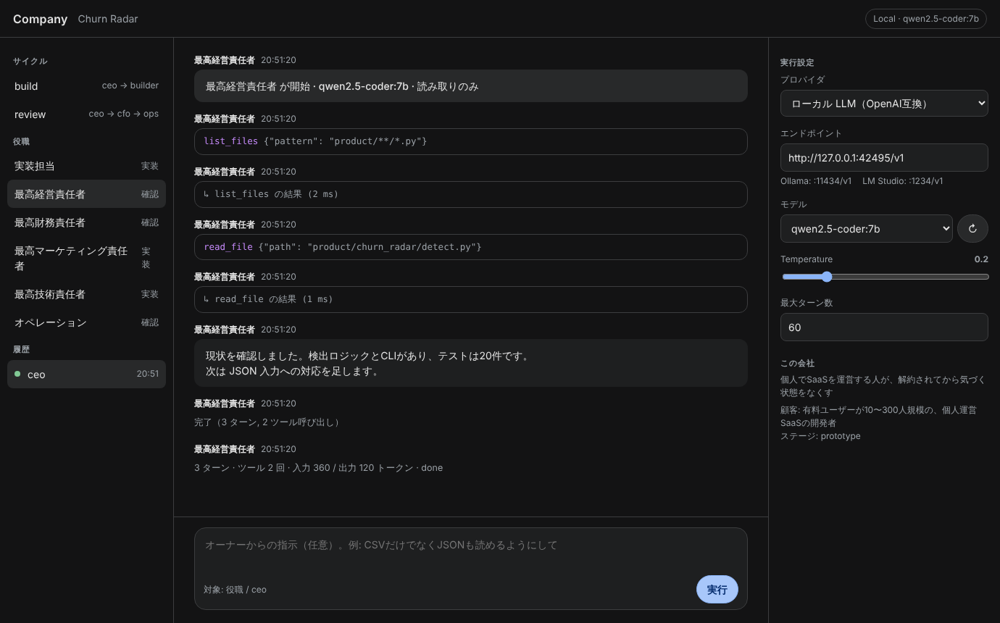

# Company

AIが経営する会社。次に何を作るかをAIが決め、AIが実装し、テストを通してコミットする。
Windows のアプリウィンドウ（またはブラウザ）から操作し、モデルはローカル LLM でもクラウドでも選べる。



## 起動（Windows）

```
run.bat
```

初回は `.venv` を作って依存を入れる。以後はウィンドウが開くだけ。
ブラウザで開きたい場合は `run.bat --browser`。

要件: Python 3.11 以上。アプリウィンドウは Edge WebView2 を使う（Windows 10/11 には通常入っている）。

### ローカル LLM を使う

[Ollama](https://ollama.com) か [LM Studio](https://lmstudio.ai) を起動しておけば、右パネルの「↻」でモデル一覧が出る。

| | エンドポイント | 備考 |
|---|---|---|
| Ollama | `http://localhost:11434/v1` | 既定値。`ollama pull qwen2.5-coder:7b` などでモデルを入れる |
| LM Studio | `http://localhost:1234/v1` | 「Local Server」を開始しておく |

ツール呼び出し（function calling）に対応したモデルが必要。Qwen 2.5 Coder、Llama 3.1 以降、Mistral などは対応している。
対応していないモデルだと、ファイルを読み書きできず文章を返すだけになる。

### Anthropic API を使う

右パネルでプロバイダを「Anthropic API」にし、API キーを入れるか環境変数 `ANTHROPIC_API_KEY` を設定する。

## 画面の使い方

AI Studio と同じ三分割。

- **左**: サイクル（`build` = 決めて作る、`review` = 進捗と数字を見る）と役職。クリックで対象を選ぶ
- **中央**: 実行ログ。モデルの発言、ツール呼び出し、その結果が順に流れる。下の欄にオーナーの指示を書ける（任意）
- **右**: プロバイダ、モデル、temperature、最大ターン数。変更は即保存される

指示を空のまま「実行」すると、役職定義（`agents/*.md`）に従って自分で判断して動く。

## 作っているもの

`product/` — **Churn Radar**。個人でSaaSを運営している人向けの、解約予兆検知。

```
cd product
python -m churn_radar sample_events.csv --today 2026-09-01
```

```
予兆 3 件（平常時の14日間と比較）

  beta-labs  停止  稼働 14日 → 0日  最終 2026-08-18 (14日前)
  gamma-io   急減  稼働 13日 → 1日  最終 2026-08-23 (9日前)
  delta-app  減少  稼働 10日 → 3日  最終 2026-08-28 (4日前)
```

アカウント自身の過去と比べて落ちたものを拾う。他社比較も絶対値のしきい値も使わない。

## 会社の仕組み

```
company.yaml         前提と権限。autonomy のフラグが唯一の制御点
agents/*.md          役職ごとの判断基準（ceo / builder / cto / cmo / cfo / ops）
company/providers.py LLM抽象層。OpenAI互換（ローカル）と Anthropic
company/tools.py     エージェントのツール。read_file / write_file / list_files / run_command
company/loop.py      ツール呼び出しループ。プロバイダ非依存
company/runner.py    サイクルの組み立て、設定の永続化、実行中ランの管理
company/server.py    HTTP API と SSE（UIが使う）
app.py               起動。pywebview でウィンドウ、--browser でブラウザ
ui/index.html        画面。依存なしの単一ファイル
product/             プロダクト本体
data/decisions/      review サイクルの記録
```

実装系の役職（builder / cto / cmo）だけ `write_file` を持つ。確認系（ceo / cfo / ops）は読み取りと
コマンド実行のみ。報告と実行が同じ権限だと、自分の作業を自分で承認する構造になるため。

ツールは全てリポジトリ内に閉じる。外のパスを指定するとエラーが返り、モデルはそれを見て別の手を打つ。

## 設計上の判断

**ローカル LLM を一級市民にする。** Claude Agent SDK はローカルモデルで動かないので、
ツール呼び出しループを自前で持つ。Anthropic もローカルも同じループを通るので、モデルを
切り替えても挙動は変わらない。

**権限は設定ファイルに集約する。** `autonomy` の各フラグは共有コンテキストに埋め込まれ、
「true のものは確認を取らずに実行してください」と指示される。

**「禁止」と「手段が無い」を分ける。** 支払いや登記は、AIが遠慮しているのではなく実行手段が
存在しない（`blocked_on_owner`）。混ぜると、エージェントが本来できることまで自粛する。

**幻覚を経営判断の土台に入れない。** 会社の状態は `company/context.py` が組み立てたブロック
として渡し、そこに無い事実は「不明」と書かせる。

## テスト

```bash
python -m unittest discover -s tests -t .          # 会社の仕組み（偽のローカルLLMで end-to-end）
cd product && python -m unittest discover -s tests  # プロダクト
```

## 未着手

- 通知（メール / Slack）
- `data/metrics.csv` の自動記入
- 週次の自動実行
- 1サイクルの費用上限（ローカルでは不要、クラウド時のみ）
